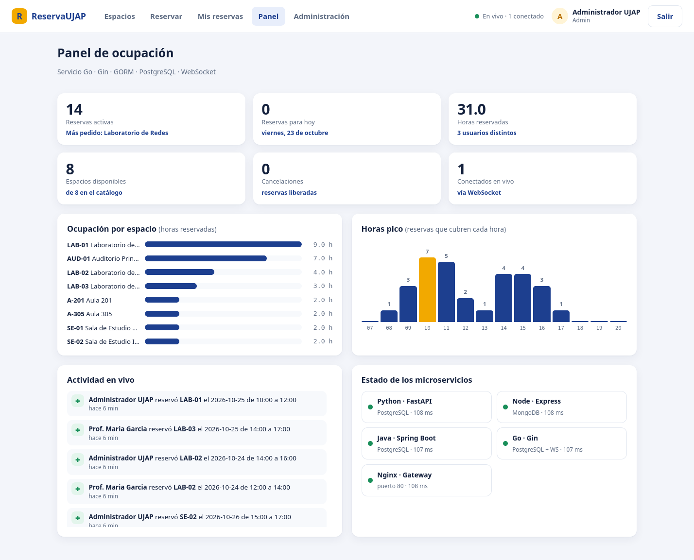
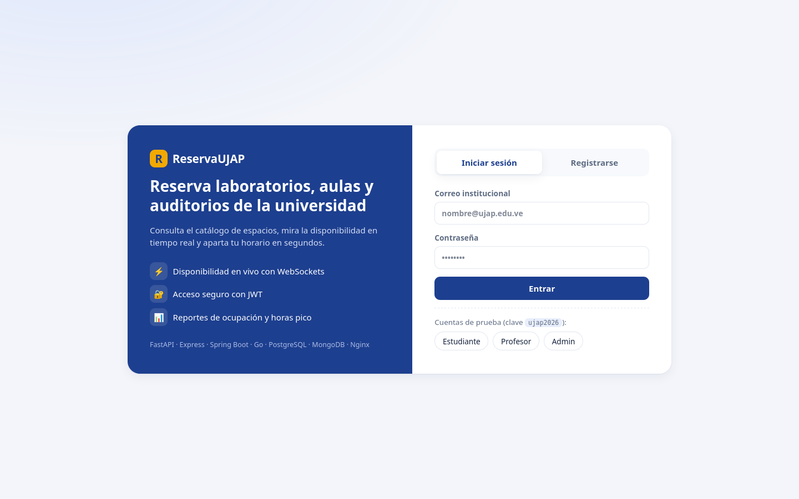
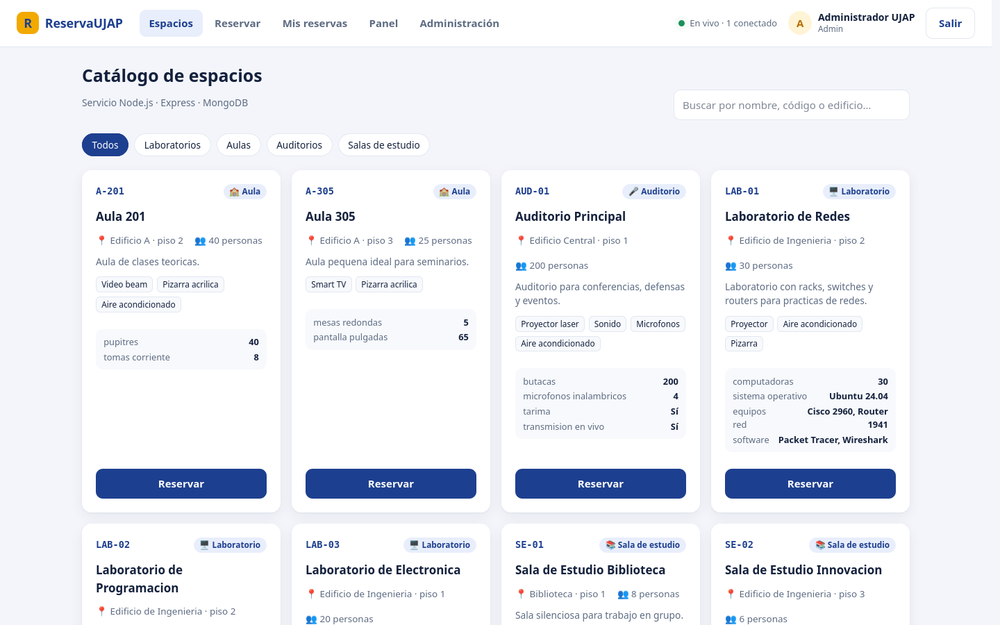
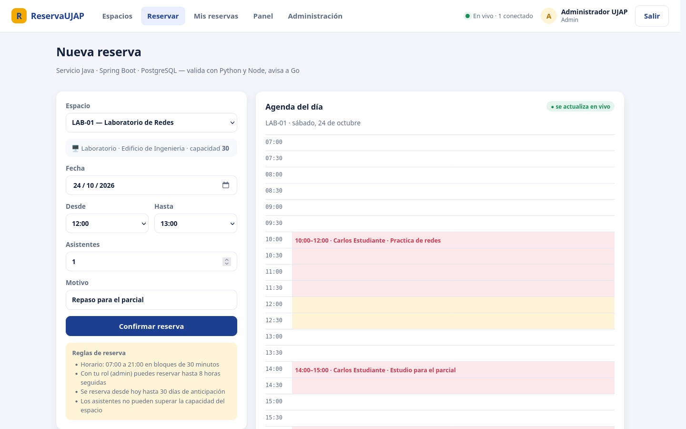
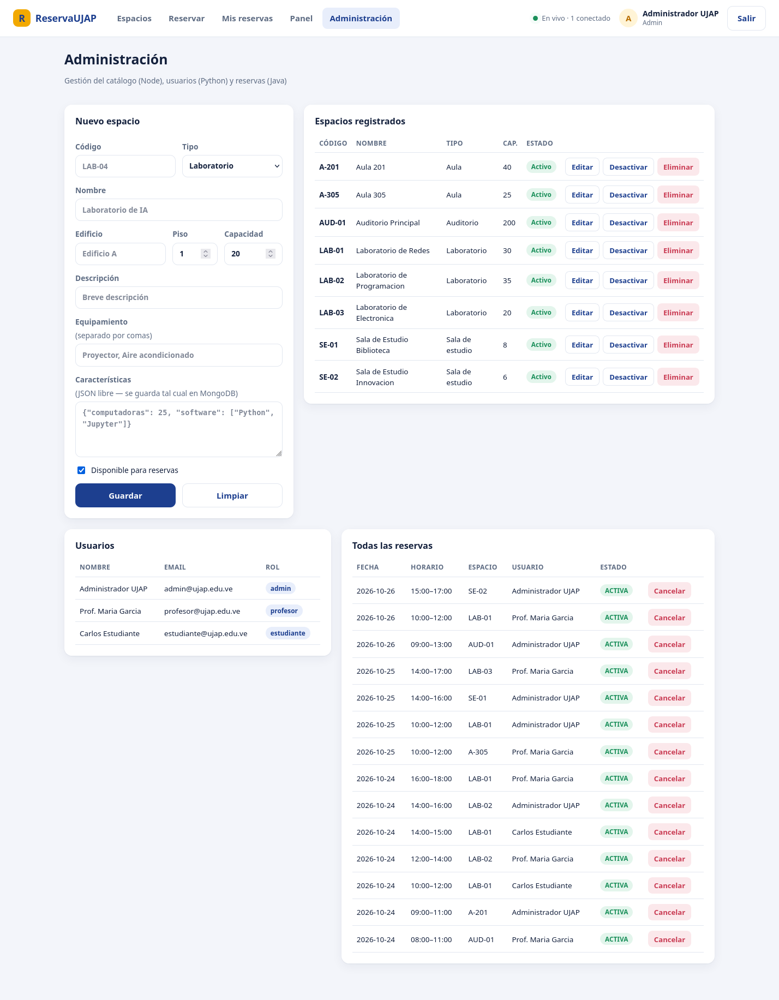
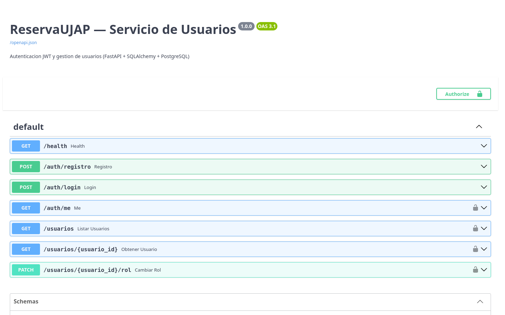
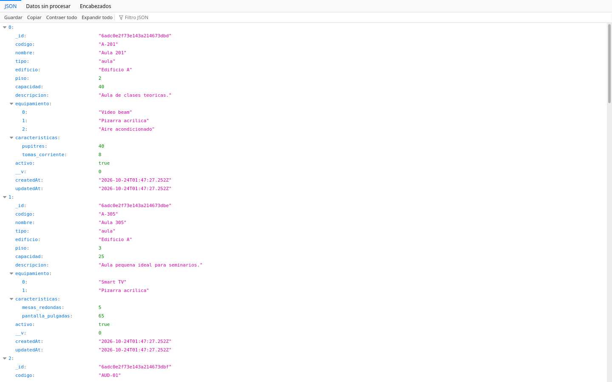
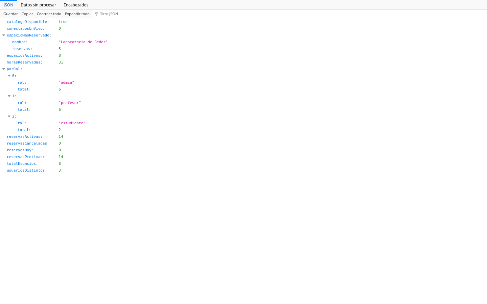
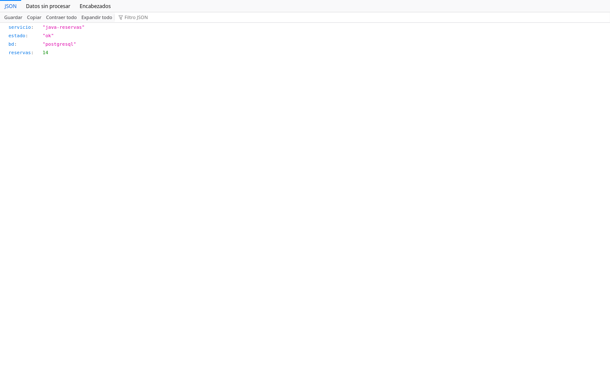

# ReservaUJAP — Sistema de reserva de espacios universitarios

ReservaUJAP es un sistema web hecho con microservicios para reservar laboratorios, aulas, auditorios y salas de estudio de la universidad. Estudiantes y profesores consultan el catálogo de espacios, ven la agenda de cada uno en tiempo real y apartan un horario. El sistema valida choques de horario, capacidad y permisos según el rol. Los administradores gestionan el catálogo y consultan reportes de ocupación.



## Integrantes

| Integrante        | Cédula        | Aporte en el repositorio                                       |
| ----------------- | ------------- | -------------------------------------------------------------- |
| Francesco Moncini | V-31.461.113  | Estructura, `.gitignore`, `.env.example`, `docker-compose.yml` y verificación final |
| Javier Vargas     | V-28.745.677  | Servicio Python (FastAPI + JWT) y API Gateway Nginx            |
| Adrián Medina     | V-31.932.916  | Servicio Node (Express + MongoDB) y frontend                   |
| Alessandro Genua  | V-31.578.008  | Servicio Java (Spring Boot + JPA) y scripts de datos de prueba |
| Freddy Parra      | V-30.479.822  | Servicio Go (Gin + GORM + WebSocket), README y capturas        |

## ¿Qué hace el sistema?

| Rol            | Puede hacer                                                                                                                               |
| -------------- | ----------------------------------------------------------------------------------------------------------------------------------------- |
| **Estudiante** | Ver el catálogo, reservar laboratorios, aulas y salas de estudio (máx. 2 h por reserva y 3 reservas activas), ver y cancelar sus reservas |
| **Profesor**   | Todo lo anterior y además reservar auditorios (máx. 4 h por reserva, sin límite de reservas activas)                                      |
| **Admin**      | Reservar cualquier espacio (máx. 8 h por reserva), crear, editar, desactivar y eliminar espacios, ver todos los usuarios y todas las reservas, cancelar cualquier reserva |

**Reglas de negocio (servicio Java):**

- Horario de 07:00 a 21:00, en bloques de 30 minutos.
- No puede haber dos reservas del mismo espacio que se crucen, ni un usuario en dos reservas a la vez.
- Los asistentes no pueden superar la capacidad del espacio.
- No se reserva en el pasado ni con más de 30 días de anticipación.
- Los espacios desactivados no se pueden reservar.

**Tiempo real (WebSocket):**

Cuando alguien reserva o cancela, todos los usuarios conectados ven el cambio al instante. La agenda del día se actualiza, el panel recalcula los reportes y aparece una notificación, todo sin recargar la página.

## Arquitectura

```
                         ┌──────────────────────────────┐
                         │      Navegador (usuario)     │
                         │   HTML + CSS + JavaScript    │
                         └──────────────┬───────────────┘
                                        │ http://localhost   (HTTP + WebSocket)
                                        ▼
                    ┌───────────────────────────────────────────┐
                    │      API GATEWAY — Nginx  :80              │
                    │  /              → frontend                 │
                    │  /api/auth, /api/usuarios → Python         │
                    │  /api/espacios  → Node                     │
                    │  /api/reservas  → Java                     │
                    │  /api/reportes, /ws → Go                   │
                    └──┬──────────┬───────────┬──────────┬───────┘
       red "frontend"  │          │           │          │
         ┌─────────────┘          │           │          └──────────────┐
         ▼                        ▼           ▼                         ▼
┌─────────────────┐   ┌──────────────────┐ ┌────────────────────┐ ┌──────────────────────┐
│ servicio-python │   │  servicio-node   │ │   servicio-java    │ │     servicio-go      │
│ FastAPI  :8000  │   │ Express  :3000   │ │ Spring Boot :8080  │ │   Gin  :8080         │
│ Auth JWT +      │◄──┤ Catálogo de      │◄┤ Reservas y reglas  ├►│ Reportes + WebSocket │
│ usuarios        │ ① │ espacios         │②│ de negocio         │③│ (hub de broadcast)   │
│ SQLAlchemy      │   │ Mongoose         │ │ Spring Data JPA    │ │ GORM                 │
└────────┬────────┘   └────────┬─────────┘ └─────────┬──────────┘ └───┬──────────┬───────┘
         │                     │       ▲             │                │          │ ④
         │   red "backend"     │       └─────────────┼────────────────┼──────────┘
         ▼                     ▼                     ▼                ▼
┌──────────────────────────────────┐  ┌─────────────────────────────────────────────┐
│        MongoDB 7 (NoSQL)         │  │            PostgreSQL 15 (SQL)              │
│  colección "espacios"            │  │  usuarios · reservas · reportes_ocupacion   │
│  (documentos JSON flexibles)     │  │  reportes_eventos                           │
└──────────────────────────────────┘  └─────────────────────────────────────────────┘
```

### Comunicación entre microservicios

Los servicios se llaman por nombre de contenedor dentro de la red Docker (`http://servicio-python:8000`, etc.):

| #   | Origen → Destino                     | ¿Para qué?                                                                            |
| --- | ------------------------------------ | ------------------------------------------------------------------------------------- |
| ①   | **Java → Python** `GET /auth/me`     | Validar el JWT del usuario y obtener su rol antes de crear o cancelar una reserva     |
| ②   | **Java → Node** `GET /espacios/{id}` | Verificar que el espacio existe, está activo y tiene capacidad suficiente             |
| ③   | **Java → Go** `POST /eventos`        | Avisar de cada reserva creada o cancelada, protegido con la cabecera `X-Internal-Key` |
| ④   | **Go → Node** `GET /espacios`        | Completar los reportes con el nombre, tipo y capacidad de cada espacio                |
| —   | **Go → Navegador** WebSocket `/ws`   | Enviar en vivo cada evento a todos los clientes conectados                            |
| —   | **Node** verifica el JWT             | Con la misma `SECRET_KEY` que usa Python para firmarlo, protege las rutas de admin    |

### Flujo de una reserva

```
Usuario ──POST /api/reservas──► Nginx ──► Java
                                           ├─► Python  /auth/me          (¿token válido? ¿rol?)
                                           ├─► Node    /espacios/{id}    (¿existe? ¿capacidad?)
                                           ├─► PostgreSQL                (¿choque de horario? → guardar)
                                           └─► Go      /eventos          (guardar ocupación)
                                                         └─► WebSocket ──► todos los navegadores
```

---

## Servicios

| Servicio | Lenguaje / Framework | Puerto (host → contenedor) | Base de datos | ORM / ODM | Endpoints principales |
|---|---|---|---|---|---|
| **gateway** | Nginx | `80 → 80` | — | — | `/`, `/api/*`, `/ws` |
| **frontend** | HTML + CSS + JS | `3000 → 80` | — | — | `index.html` |
| **servicio-python** | Python 3.12 · FastAPI | `8001 → 8000` | PostgreSQL | SQLAlchemy | `POST /auth/registro`, `POST /auth/login`, `GET /auth/me`, `GET /usuarios`, `GET /usuarios/{id}`, `PATCH /usuarios/{id}/rol` |
| **servicio-node** | Node.js 20 · Express | `8002 → 3000` | MongoDB | Mongoose | `GET /espacios`, `GET /espacios/{id}`, `POST /espacios`, `PUT /espacios/{id}`, `DELETE /espacios/{id}` |
| **servicio-java** | Java 21 · Spring Boot 3 | `8003 → 8080` | PostgreSQL | Spring Data JPA | `POST /reservas`, `GET /reservas/mias`, `GET /reservas/disponibilidad`, `GET /reservas/{id}`, `PATCH /reservas/{id}/cancelar`, `GET /reservas` |
| **servicio-go** | Go 1.25 · Gin | `8004 → 8080` | PostgreSQL | GORM | `GET /reportes/resumen`, `/reportes/ocupacion`, `/reportes/horas-pico`, `/reportes/por-tipo`, `/reportes/actividad`, `WS /ws`, `POST /eventos` (interno) |
| **postgres** | PostgreSQL 15 | interno | — | — | volumen `pgdata` |
| **mongodb** | MongoDB 7 | interno | — | — | volumen `mongodata` |

Todos los servicios exponen `GET /health`, que el gateway publica como `/api/health/{python|node|java|go|gateway}`.

---

## ¿Cómo ejecutarlo?

**Requisito:** Docker Desktop (o Docker Engine con Compose v2).

```bash
git clone https://github.com/USUARIO/Ultimo-Proyecto-Lenguaje.git
cd Ultimo-Proyecto-Lenguaje
cp .env.example .env          # opcional: cambia las credenciales
docker compose up --build
```

> Si no creas el `.env`, el `docker-compose.yml` usa valores de desarrollo por defecto, así que el sistema siempre levanta con un solo comando.

La primera vez tarda unos minutos porque compila Java y Go. Cuando todos los contenedores estén `healthy`, abre:

| URL | Qué es |
|---|---|
| **http://localhost** | Aplicación completa (a través del API Gateway) |
| http://localhost:8001/docs | Swagger del servicio Python |
| http://localhost:8002/espacios | Servicio Node directo |
| http://localhost:8003/health | Servicio Java directo |
| http://localhost:8004/reportes/resumen | Servicio Go directo |

### Cuentas de prueba

Se crean automáticamente al arrancar (contraseña `ujap2026`, configurable con `SEED_PASSWORD`):

| Rol | Email |
|---|---|
| Admin | `admin@ujap.edu.ve` |
| Profesor | `profesor@ujap.edu.ve` |
| Estudiante | `estudiante@ujap.edu.ve` |

### Comandos útiles

```bash
docker compose ps                         # estado y healthchecks
docker compose logs -f servicio-java      # logs de un servicio
docker compose down                       # detener (los datos se conservan en los volúmenes)
docker compose down -v                    # detener y borrar los datos
```

### Problemas comunes

| Síntoma | Solución |
|---|---|
| El puerto 80 está ocupado | Define `GATEWAY_PORT=8080` en el `.env` y entra por `http://localhost:8080` |
| `container name "/ujap-..." is already in use` | Hay otra copia del proyecto levantada (los contenedores tienen nombres fijos y usan los mismos puertos). Ejecuta `docker compose down` en la carpeta de esa copia |
| Los scripts de datos de prueba dicen *"El sistema no está corriendo"* aunque sí lo está | Tu terminal apunta a otro motor de Docker (por ejemplo, Docker Desktop y Docker Engine instalados a la vez). Revisa con `docker context ls` y elige el motor donde levantaste el proyecto con `docker context use <nombre>` |

### Datos de prueba

Con el sistema levantado, estos scripts llenan el sistema con datos de ejemplo para la demostración y luego los quitan. No borran archivos ni los datos originales, solo lo que crearon.

| Acción | Windows (PowerShell) | Linux / Mac |
|---|---|---|
| Cargar | `powershell -ExecutionPolicy Bypass -File scripts\cargar-datos-prueba.ps1` | `bash scripts/cargar-datos-prueba.sh` |
| Quitar | `powershell -ExecutionPolicy Bypass -File scripts\quitar-datos-prueba.ps1` | `bash scripts/quitar-datos-prueba.sh` |

**¿Qué se carga?**

- 9 usuarios (6 estudiantes y 3 profesores) con correos `@prueba.ujap.edu.ve` y clave `prueba2026`.
- 2 espacios con código `PRB-`.
- 30 reservas repartidas en los próximos 6 días, de las cuales 2 se cancelan.

Las reservas pasan por el flujo real: Java las valida con Python y Node, y Go las registra y las transmite por WebSocket. Así los reportes y el panel en vivo se llenan solos.

La lógica está en `scripts/datos_prueba.py` y se ejecuta **dentro del contenedor de Python**, así que no hace falta instalar nada además de Docker. Para quitar los datos, el script borra solo las reservas de esos usuarios o espacios, sus registros de reportes, los usuarios `@prueba.ujap.edu.ve` y los espacios `PRB-`.

---

## Docker Compose

- **Un Dockerfile por servicio.** Java y Go usan *multi-stage build*: compilan en una imagen y se ejecutan en una imagen liviana.
- **Redes:** `backend` (bases de datos y servicios) y `frontend` (servicios, frontend y gateway). Las bases de datos no están en la red `frontend`.
- **Healthchecks** en todos los contenedores: `pg_isready`, `mongosh ping` y `GET /health` en cada servicio.
- **`depends_on` con `condition: service_healthy`:** Java espera a PostgreSQL, Python, Node y Go, el gateway espera a todos los servicios.
- **Volúmenes persistentes:** `pgdata` y `mongodata`.
- **`restart: unless-stopped`** para recuperarse de fallos.

## Variables de entorno

Las credenciales no están en el código. Se definen en `.env`, que está en `.gitignore`, el repositorio solo incluye `.env.example`. Cada lenguaje las lee con su librería dotenv:

| Lenguaje | ¿Cómo se leen?                                                                                                                     |
| -------- | ---------------------------------------------------------------------------------------------------------------------------------- |
| Python   | `python-dotenv` → `load_dotenv()` + `os.getenv("DATABASE_URL")`                                                                    |
| Node.js  | `dotenv` → `require('dotenv').config()` + `process.env.MONGO_URL`                                                                  |
| Go       | `github.com/joho/godotenv` → `godotenv.Load()` + `os.Getenv("DATABASE_URL")`                                                       |
| Java     | `application.properties` → `${DB_URL}`, `${DB_USER}`, `${DB_PASS}` (más `spring.config.import=optional:file:../.env[.properties]`) |

| Variable | Usada por | Descripción |
|---|---|---|
| `DB_USER`, `DB_PASS`, `DB_NAME` | postgres, Python, Java, Go | Credenciales de PostgreSQL |
| `MONGO_USER`, `MONGO_PASS`, `MONGO_DB` | mongodb, Node | Credenciales de MongoDB |
| `SECRET_KEY` | Python (firma), Node (verifica) | Clave del JWT (HS256) |
| `TOKEN_EXPIRY_MIN` | Python | Minutos de validez del token |
| `INTERNAL_API_KEY` | Java, Go | Clave para la llamada interna Java → Go |
| `SEED_PASSWORD` | Python | Contraseña de las cuentas de prueba |
| `APP_TIMEZONE` | Java, Go | Zona horaria de las reservas (`America/Caracas`) |
| `GATEWAY_PORT` | gateway | Puerto público (por defecto 80) |

---

## Estructura del repositorio

```
Ultimo-Proyecto-Lenguaje/
├── .env.example              ← plantilla de variables (el .env real no se sube)
├── .gitignore
├── .gitattributes            ← los .sh siempre con saltos de línea LF
├── docker-compose.yml        ← orquesta los 8 contenedores
├── README.md
├── docs/capturas/            ← capturas usadas en este README
├── scripts/                  ← datos de prueba (ver sección "Datos de prueba")
│   ├── datos_prueba.py       ← lógica común (se ejecuta dentro del contenedor de Python)
│   ├── cargar-datos-prueba.ps1 / cargar-datos-prueba.sh
│   └── quitar-datos-prueba.ps1 / quitar-datos-prueba.sh
├── nginx/
│   └── nginx.conf            ← API Gateway
├── servicio-python/          ← FastAPI + SQLAlchemy + JWT
│   ├── Dockerfile
│   ├── .dockerignore
│   ├── main.py               ← rutas
│   ├── auth.py               ← bcrypt + JWT
│   ├── database.py           ← modelo Usuario
│   └── requirements.txt
├── servicio-node/            ← Express + Mongoose
│   ├── Dockerfile
│   ├── .dockerignore
│   ├── index.js              ← rutas CRUD
│   ├── models/Espacio.js     ← schema de Mongoose
│   ├── middleware/auth.js    ← verificación del JWT
│   ├── seed.js               ← catálogo inicial
│   └── package.json
├── servicio-java/            ← Spring Boot + Spring Data JPA
│   ├── Dockerfile
│   ├── .dockerignore
│   ├── pom.xml
│   ├── src/main/resources/
│   │   └── application.properties ← lee DB_URL, DB_USER, DB_PASS del entorno
│   └── src/main/java/ve/edu/ujap/reservas/
│       ├── ReservasApplication.java
│       ├── controller/       ← ReservaController, HealthController
│       ├── service/          ← ReservaService (reglas de negocio)
│       ├── repository/       ← ReservaRepository (JpaRepository)
│       ├── model/            ← Reserva (@Entity), EstadoReserva
│       ├── client/           ← ServiciosClient (llama a Python, Node y Go)
│       ├── dto/              ← ReservaRequest
│       ├── exception/        ← ApiException, GlobalExceptionHandler
│       └── config/           ← CorsConfig
├── servicio-go/              ← Gin + GORM + gorilla/websocket
│   ├── Dockerfile
│   ├── .dockerignore
│   ├── main.go               ← arranque y rutas
│   ├── handlers.go           ← eventos y reportes
│   ├── hub.go                ← hub de WebSocket (broadcast)
│   ├── catalogo.go           ← cliente HTTP del servicio Node
│   ├── models.go             ← modelos GORM
│   ├── go.mod
│   └── go.sum
└── frontend/
    ├── Dockerfile
    ├── index.html
    ├── style.css
    └── app.js
```

---

## Capturas

### Inicio de sesión


### Catálogo de espacios (Node + MongoDB)
Cada espacio tiene un documento `caracteristicas` distinto (PCs y software, butacas, kits de electrónica…), algo que en MongoDB se guarda sin un esquema rígido.


### Nueva reserva con agenda en vivo (Java + WebSocket)


### Mis reservas


### Panel de ocupación (Go)


### Administración (Node + Python + Java)


### Servicios respondiendo directamente

**Python — Swagger UI (`localhost:8001/docs`)**


**Node — `GET localhost:8002/espacios`**


**Go — `GET localhost:8004/reportes/resumen`**


**Java — `GET localhost/api/health/java` (a través del gateway)**

